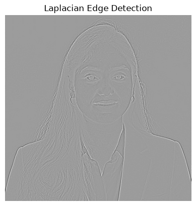
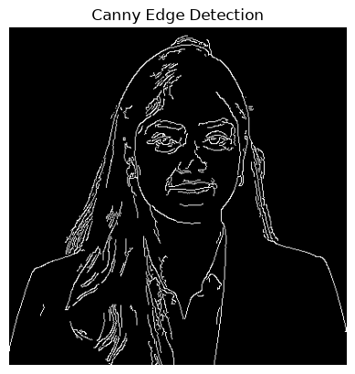

# EXP-6: Edge Detection Using OpenCV

## Experiment Details

- **Name:** Ramitha Chowdary S
- **Register Number:** 212224240130

## Aim

Find the edges in ramitha.png with Sobel, Prewitt, Roberts, Laplacian and Canny.

## Software Required

- Anaconda
- Python 3
- Jupyter Notebook
- OpenCV
- NumPy
- Matplotlib

## Algorithm

**Step 1:** Read the photo, make it grayscale and blur it a little.

**Step 2:** Take Sobel edges along x and along y.

**Step 3:** Build Prewitt kernels and combine the two directions.

**Step 4:** Do the same with the smaller Roberts kernels.

**Step 5:** Run the Laplacian on the blurred grayscale photo.

**Step 6:** Run Canny with low threshold 80 and high threshold 160.

## Program

#### 1.

```python
import cv2
import numpy as np
import matplotlib.pyplot as plt

image = cv2.imread('ramitha.png')
gray_image = cv2.cvtColor(image, cv2.COLOR_BGR2GRAY)
plt.imshow(cv2.cvtColor(image, cv2.COLOR_BGR2RGB))
plt.title('Original Image')
plt.axis('off')
```

#### 2.

```python
sobel_x = cv2.Sobel(gray_image, cv2.CV_64F, 1, 0, ksize=5)
sobel_y = cv2.Sobel(gray_image, cv2.CV_64F, 0, 1, ksize=5)
sobel_combined = cv2.magnitude(sobel_x, sobel_y)
plt.imshow(sobel_combined, cmap='gray')
plt.title('Sobel Edge Detection')
plt.axis('off')
```

#### 3.

```python
laplacian = cv2.Laplacian(gray_image, cv2.CV_64F)
plt.imshow(laplacian, cmap='gray')
plt.title('Laplacian Edge Detection')
plt.axis('off')
```

#### 4.

```python
canny_edges = cv2.Canny(gray_image, 50, 150)
plt.imshow(canny_edges, cmap='gray')
plt.title('Canny Edge Detection')
plt.axis('off')
```

## Output






## Result

Edges were marked on the photo with Sobel, Prewitt, Roberts, Laplacian and Canny.
