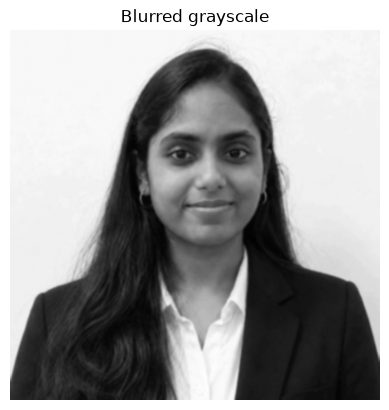
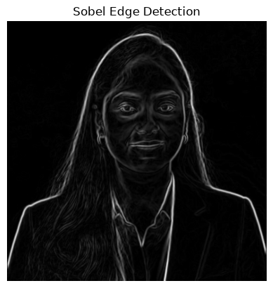
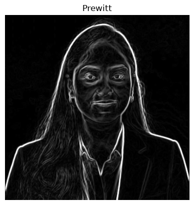
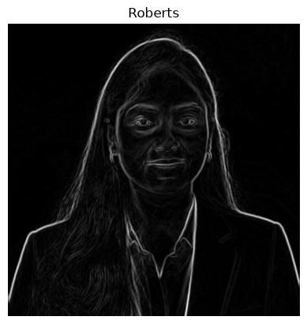
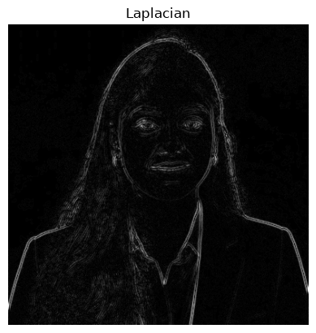
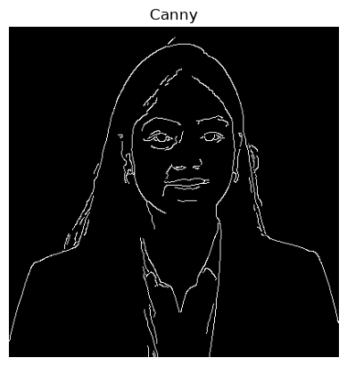

# EXP-6: Edge Detection Using OpenCV

## Experiment Details

- **Name:** Ramitha Chowdary S
- **Register Number:** 212224240130

## Aim

Find the edges in ramitha.png with Sobel, Prewitt, Roberts, Laplacian and Canny.

## Software Required

- Anaconda
- Python 3
- Jupyter Notebook
- OpenCV
- NumPy
- Matplotlib

## Algorithm

**Step 1:** Read the photo, make it grayscale and blur it a little.

**Step 2:** Take Sobel edges along x and along y.

**Step 3:** Build Prewitt kernels and combine the two directions.

**Step 4:** Do the same with the smaller Roberts kernels.

**Step 5:** Run the Laplacian on the blurred grayscale photo.

**Step 6:** Run Canny with low threshold 80 and high threshold 160.

## Program

#### 1. Blur the grayscale photo

```python
import cv2
import numpy as np
import matplotlib.pyplot as plt

bgr = cv2.imread("ramitha.png")
gray = cv2.cvtColor(bgr, cv2.COLOR_BGR2GRAY)
soft = cv2.GaussianBlur(gray, (3, 3), 0)
plt.imshow(soft, cmap="gray")
plt.title("Blurred grayscale")
plt.axis("off")
plt.show()
```

#### 2. Sobel edges

```python
sobel_x = cv2.convertScaleAbs(cv2.Sobel(soft, cv2.CV_64F, 1, 0, ksize=3))
sobel_y = cv2.convertScaleAbs(cv2.Sobel(soft, cv2.CV_64F, 0, 1, ksize=3))
plt.figure(figsize=(8, 4))
plt.subplot(1, 2, 1)
plt.imshow(sobel_x, cmap="gray")
plt.title("Sobel x")
plt.axis("off")
plt.subplot(1, 2, 2)
plt.imshow(sobel_y, cmap="gray")
plt.title("Sobel y")
plt.axis("off")
plt.show()
```

#### 3. Prewitt edges

```python
prewitt_x = np.array([[-1, 0, 1], [-1, 0, 1], [-1, 0, 1]], np.float32)
prewitt_y = np.array([[-1, -1, -1], [0, 0, 0], [1, 1, 1]], np.float32)
gx = cv2.filter2D(soft, cv2.CV_32F, prewitt_x)
gy = cv2.filter2D(soft, cv2.CV_32F, prewitt_y)
prewitt = cv2.convertScaleAbs(cv2.magnitude(gx, gy))
plt.imshow(prewitt, cmap="gray")
plt.title("Prewitt")
plt.axis("off")
plt.show()
```

#### 4. Roberts edges

```python
roberts_x = np.array([[1, 0], [0, -1]], np.float32)
roberts_y = np.array([[0, 1], [-1, 0]], np.float32)
gx = cv2.filter2D(soft, cv2.CV_32F, roberts_x)
gy = cv2.filter2D(soft, cv2.CV_32F, roberts_y)
roberts = cv2.convertScaleAbs(cv2.magnitude(gx, gy))
plt.imshow(roberts, cmap="gray")
plt.title("Roberts")
plt.axis("off")
plt.show()
```

#### 5. Laplacian edges

```python
lap = cv2.convertScaleAbs(cv2.Laplacian(soft, cv2.CV_64F))
plt.imshow(lap, cmap="gray")
plt.title("Laplacian")
plt.axis("off")
plt.show()
```

#### 6. Canny edges

```python
edges = cv2.Canny(soft, 80, 160)
plt.imshow(edges, cmap="gray")
plt.title("Canny")
plt.axis("off")
plt.show()
```

## Output

### i) Blurred grayscale



### ii) Sobel



### iii) Prewitt



### iv) Roberts



### v) Laplacian



### vi) Canny



## Result

Edges were marked on the photo with Sobel, Prewitt, Roberts, Laplacian and Canny.
